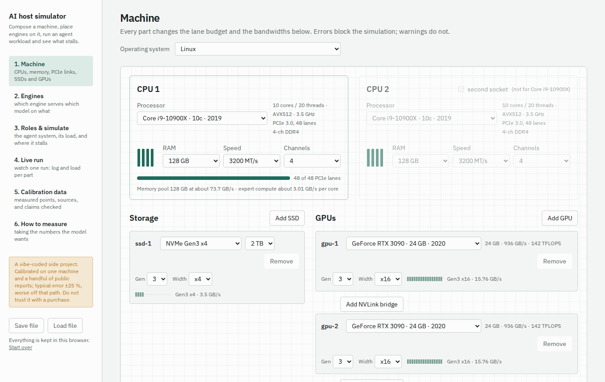
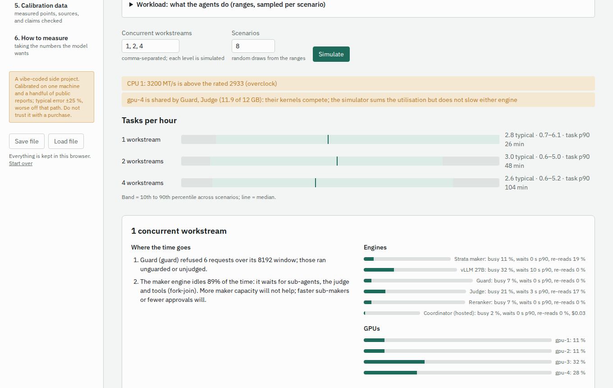

# rigsim

Simulate an LLM inference host before you buy it: GPUs, PCIe, engines, agent workloads.

> **Read this first.** This is a vibe-coded side project: the code, the performance model and these pages were
> written by an AI assistant in chat sessions, on the direction of one person, over a few days. It is not a
> product and not a research result. Nobody has reviewed the model line by line. It was calibrated on **one
> machine** plus a handful of public benchmark reports and reaches roughly **±25 %** on held-out points from
> similar hardware; outside that path it can be off by a factor. Use it to reason about *relative* choices
> and to see which measurement would settle a question. **Do not base a purchase or a design decision on it
> without measuring.** How it was calibrated and validated is spelled out [below](#how-it-was-calibrated-and-validated)
> and on the app's *Calibration data* page.

A planner for machines that serve local language models to an agent system. Compose a computer (CPUs,
memory, PCIe links, SSDs, GPUs), place inference engines on it, assign them to the roles of a
[Turnstone](https://github.com/turnstonelabs/turnstone)-style agent setup, run a simulated workload and see
what stalls: a saturated card, a serial admission queue, a judge on the critical path, re-read prompts, a tool
search on the CPU.

Everything runs in your browser (Python on [Pyodide](https://pyodide.org) in a web worker). The site is static:
no server, no accounts, nothing is sent anywhere. Configurations can be saved and loaded as JSON files.



## What it does

1. **Machine** — one or two CPUs from a catalog of ~50 parts (2011–2026) with vector ISA, core mix, memory
   channels and lanes; a memory pool per socket; SSDs on one side, GPUs on the other, every PCIe link with its
   own generation and width — or an external Thunderbolt 3/4/5 or USB4 link for eGPU enclosures, which caps
   bandwidth and costs 4 CPU lanes only when the CPU has no integrated port (pre-2022, non-SoC: a
   controller card); NVLink bridges between adjacent identical GPUs; an operating-system
   switch; a **power cap** per GPU within the card's settable range (decode barely moves, prompt
   processing follows the clock). A **prebuilt systems** dropdown fills the page with a DGX Spark, Mac Studio M4 Max / M3 Ultra,
   Mac Pro M2 Ultra, Framework Desktop (Strix Halo) or a typical desktop; everything stays editable, so a
   Spark with an eGPU on its TB4 port is two clicks. Unified-memory machines model the iGPU as sharing the
   pool's bandwidth. The lane budget and all bandwidths update with every change.
2. **Engines** — one model per engine. Strata, vLLM, llama.cpp and a hosted API, with versions that define the
   arguments. Assign GPUs, a CPU, cores and a model SSD. Beside each engine: prompt-reading rate, writing rate
   alone and with several requests, expert-cache hit, KV room, VRAM per card, and why something does not fit.
   Measured values can be entered and override the derived ones. Arguments follow the rules the engines
   themselves apply (`backend/app/argrules.py`, from the engines' documentation): what has no effect in the
   current setup is greyed out with the reason, what the engine would override is shown as the forced value
   — a Strata `--pipeline-windows` with more than one slot, `--batch-mtp` on the pipelined path, vLLM FP8 on a
   pre-Ada card, tensor × pipeline parallel against the assigned GPUs, a quantised llama.cpp KV cache without
   flash attention. Every number typed is kept inside its documented range, in the page and in the model.
   A Strata engine also gets a **static memory layout**: every card's VRAM as labelled boxes (dense weights,
   KV per slot, scratch, CUDA context, display, other engines, kept-free margin, and the expert cache filling
   the rest), the host RAM pool (OS reserve, the expert pack, pinned buffers, streamed KV, parking with "fits
   at most N full conversations"), and every link with its worst-case load — all slots writing at the
   engine's top rate, a prefill chunk in flight, the expert-cache hit rate guessed from the share of experts
   held (or set by hand). Overshoot is drawn past the edge and named in a headline, together with what to
   shrink first and how far a PCIe link is oversubscribed. Estimated boxes have dashed borders and can be
   overridden in a folded "fixed allocations" tab; those values move with driver, OS and version and are
   deliberately not collected. A per-GPU **screen attached** checkbox on the machine page reserves the
   desktop's VRAM.
3. **Roles & simulate** — coordinator, maker, sub-makers, output guard, judge, reranker. A workload described
   as ranges, sampled per scenario, with two levers: *work per task* (how many turns and tool calls a task
   takes — a stronger model needs fewer) and *attempts per task* (how often a task is redone). One button
   runs every concurrency level. The headline numbers are machine-level and model-independent: **tokens
   per second** served (reads and writes), **watts**, **tokens per second per watt** and one **machine
   utilisation** figure (busy share averaged over every GPU and the CPU pool). Tasks per hour is shown
   below them, because it depends entirely on the models and the levers; then utilisation per engine
   and GPU with each engine's tok/s and watts, hosted cost, call rates, and a ranked list of what limits
   throughput. A **Cancel** button stops a long run (the in-browser simulator restarts on the next call).
4. **Live run** — one scenario replayed at 10–1000×: a log of every request and gauges per engine, GPU, PCIe
   link, CPU cores and memory bandwidth.
5. **Calibration data** — every measured point the model was fitted to or checked against, with sources, and
   claims from unmethodical pages checked against the simulator.
6. **How to measure** — taking the numbers the model wants, with snippets and the scripts in `bench/`.



## How it was calibrated and validated

The performance model (`backend/app/perf.py`) is bandwidth-centred: writing a token reads the weights it
touches once per step, from VRAM, host RAM through the CPU, or PCIe; reading a prompt is compute-bound plus
the streaming of non-resident experts plus the attention products, which grow with context; parallel
requests share dense weights but hardly share experts. About a dozen constants (bandwidth efficiency, per-layer
overhead, expert-cache hit skew, per-core expert rate by vector ISA, PCIe small-copy efficiency, an
architecture factor for Pascal/Turing, an OS factor) were **hand-fitted** to twelve measured points:

- nine from one machine (Core i9-10900X, 4-channel DDR4-3200, three RTX 3090 and one RTX 3060, Linux): Strata
  on one and two cards, vLLM and llama.cpp with a 27B model, a 3B guard, a reranker on the CPU;
- three from Strata community reports with documented hardware (RTX 3060 + i7-12700, RTX 4090 + 7950X,
  RTX 2080 Ti + Threadripper 3960X);
- five for the unified-memory prebuilts, from the llama.cpp maintainers' own tables: M2 Ultra writing in F16
  and Q4_0 (which fix Metal's bandwidth efficiency per weight format), M5 Max (the tensor-unit generation),
  Strix Halo (RDNA on LPDDR5X) and the DGX Spark (gpt-oss-120b on the GB10). Each sets one architecture
  factor; everything else on those platforms is held out.

Forty-one further points were **held out**: more cells from the same machine, Strata reports for RTX 5090,
2 × TITAN RTX and 2 × RTX 4000 Ada, the llama.cpp CUDA table with build numbers (Llama 3.1 8B, Qwen2.5-32B
on 3090 / 4090), and across the prebuilts: M1 Ultra, M3 Ultra, M4 Max, M5 Max and M5 Ultra in other
formats and in prompt processing (llama.cpp discussion #4167), Strix Halo prompt processing and a 27B dense
model with and without MTP plus the RX 7900 XTX (ROCm scoreboard #15021), and the Spark's prompt rate
(#16578). Result: 17 of 17 calibration points and 38 of 41 held-out points within ±30 %, median error
8 % and 14 %, worst held-out miss 37 %. `backend/tests/test_validation.py` keeps the model inside those
bounds; the *Calibration data* page recomputes the whole table from the current code.

**On tasks per hour.** A "task" here is whatever the workload ranges describe; a better model finishes a
task in fewer turns and fewer retries, so the same hardware yields more tasks per hour with it. The
simulator cannot know that from the hardware, which is why the levers exist and why the machine-level
tokens per second, watts and utilisation are the numbers to compare machines by.

**Explicitly out of scope: sharing a card or the CPU's cores between engines.** Every GPU holds exactly one
engine, and the engines on a CPU cannot ask for more cores together than it has; the interface refuses both
and the model reports them as errors. Two engines on one card interact through kernel scheduling, memory
contention, VRAM fragmentation and each engine's own reservation logic (Strata's `--vram-reserve-later-mib`,
vLLM's `gpu_memory_utilization`, a desktop compositor on the side) — a space of details with no end, where
every number would be a guess that no measurement set could validate. The reference machine itself shares a
card between its judge and its guard; the example configuration therefore leaves the judge role empty rather
than pretend. If you need that layout, measure it.

What this does **not** cover: models other than the ones in the catalog (sizes are spec-sheet figures and
parameter counts, not measurements), GPUs the reports did not include (spec-sheet bandwidth with the same
efficiency constants), the power-cap curve beyond one card and one cap (the box's 3090s at 250 W; the
curve's shape is a guess until capped measurement records arrive), Strata on unified memory (no public measurement exists; the CPU expert path on NEON
is a guess),
chipset lanes and slot spacing, thermals and power limits, answer quality. The workload ranges on the roles
page are assumptions until real traces replace them. See `docs/predictions/` for numbers written down before
a benchmark pass, to be scored against it.

## Run it

**Hosted static site** — any static host works; the build is a folder of files (about 14 MB with the Pyodide
runtime). Build command `cd frontend && npm ci && npm run build`, output directory `frontend/dist`.

- GitHub Pages: enable Pages with source "GitHub Actions"; `.github/workflows/pages.yml` builds, tests and
  deploys on every push to `main`. `ci.yml` runs the tests on pull requests; `intake.yml` handles the issue forms.
- Cloudflare Pages: connect the repo, set the build command and output directory above.
- Hugging Face static Space: upload `frontend/dist`.

**Locally**

```
cd frontend && npm ci && npm run build && npx serve dist        # or any static file server
docker compose up --build                                       # nginx serving the same files on :8080
```

**Development**

```
cd backend && pip install fastapi "uvicorn[standard]" pytest httpx
uvicorn app.main:app --port 8080            # optional dev server with the same functions behind HTTP
cd frontend && npm run dev                  # Vite dev server; runs Python in the browser by default
VITE_API_BASE=http://127.0.0.1:8080 npm run dev   # ...or against the dev server
```

Browser checks (in Chromium against the built site; also a CI job): the walkthrough (34 checks across every
page) and the robustness suite (35 checks: every defect found in exploratory testing, replayed):
`cd frontend && npm run build && (cd dist && python3 -m http.server 8090 &) && npx playwright-core install chromium && npm run e2e`.

Tests: `cd backend && python -m pytest -q` (machine rules, calibration bounds, API; 20) and
`cd frontend && VITE_API_BASE=http://127.0.0.1:8080 npm test` (user flows in a DOM against the dev server; 14).

## Layout

```
backend/app/catalog/   CPUs, GPUs, SSDs, models, engines with per-version argument schemas
backend/app/machine.py validation, link and memory bandwidths, CPU expert rate
backend/app/perf.py    engine budgets from hardware, model and arguments
backend/app/sim/       event-driven fluid simulation, engine models, Turnstone-shaped workload, bottlenecks
backend/app/calibration.py   the measured points, sources and checked claims (Calibration page)
backend/app/api.py     function-level API used by the browser build; main.py wraps it for the dev server
frontend/src/          React + TypeScript + Tailwind; py.worker.ts runs the Python in a web worker
bench/                 the measurement scripts (standalone) and the unattended queue (reference)
docs/predictions/      predictions written before benchmark passes, for scoring
```

## Contributing measurements

Measured points are the most useful contribution, and there is a fixed path for them:

1. Measure (`bench/README.md`), enter the numbers in the engine's *Measured on real hardware* block.
2. Click **Export measurement**, fill the short method form (tool, runs, streams, context, power limit,
   driver, date, an alias). The app validates the record: parts must exist in the catalogs, numbers must
   stay inside physical bounds, free text must carry no names or links.
3. Open the **Submit a measurement** issue form and paste the file's content. An Action validates it, posts
   the result as a comment, and opens a pull request with the file; the maintainer only merges. A pull request
   adding the file to `measurements/` directly works too. Missing CPU or GPU? The **Add a part** form takes the
   spec-sheet figures and a source URL. Parts are checked for internal consistency (bandwidth = bus × rate,
   sizes that exist, per-year envelopes, ISA by vendor and year), the source must be a page on the vendor's
   own domain (nvidia.com, amd.com, intel.com) that names the part, and accepted parts land in quarantine (`catalog/proposed.json`): usable in the
   app, tagged "community, unverified", never used for calibration until a maintainer promotes them. New
   accounts get a `needs-review` label instead of an automatic pull request.

Records are shipped with the site and clustered by GPUs, engine, model, quant and streams. On any engine card
whose configuration matches a cluster, the app offers the cluster's median as a one-click measured value with
count, spread and a trust score; the Calibration page lists the clusters with the model's error. Records never
move the model's constants by themselves — that is a separate, deliberate refit against the calibration set.
Format: `measurements/schema.json`. New parts for the catalogs need a public spec sheet. Model
changes should keep `backend/tests/test_validation.py` green or explain why the bounds move.

## License

Apache License 2.0 — see `LICENSE` and `NOTICE`. Contributors in `CONTRIBUTORS.md`.
